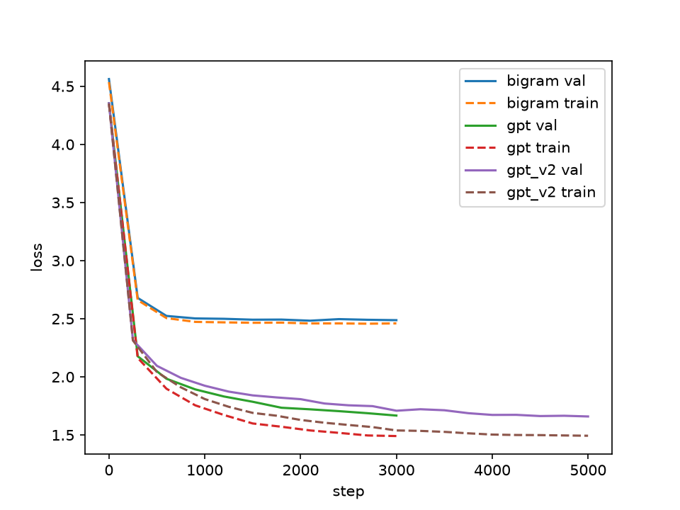

# GPT from scratch

A small character-level GPT in PyTorch, trained on Tiny Shakespeare (about 1.1M characters, 65 different characters). It learns to predict the next character, and then I use it to generate text.

I first trained a bigram model (it only looks at the current character) as a baseline, then the transformer, so I could see what attention actually adds. After that I made a second version of the GPT with better training settings.

## Results

| model | parameters | train loss | val loss |
|---|---|---|---|
| bigram | 0.004M | 2.460 | 2.488 |
| GPT v1 (4 layers, 4 heads, 128 dim) | 0.817M | 1.491 | 1.667 |
| GPT v2 (same model, better training) | 0.817M | 1.493 | 1.659 |



The bigram stops at about 2.5, because one character is not enough context to guess the next one. The GPT looks at the previous 64 characters and gets down to about 1.66.

For v2 I kept the same model but raised dropout from 0.1 to 0.2, added weight decay and a learning rate schedule (short warmup, then decay), and trained for 5000 steps instead of 3000. Val loss only went from 1.667 to 1.659, which is within the noise of the measurement (about ±0.01 between evaluations of the same model), so these changes did not really help this model. The gap between train and val is still about 0.17, so it overfits a bit.

Text from the bigram (step 2999):
```
Whe
n,
Blle ldr:
'?
Thtry aroue gofe ry f y fout st spastinester bes easiritou itondanqu by bo it,
```

The GPT has learned the format of a play (character names, line breaks) and many real words, but the sentences don't mean much yet.

## How to run

1. `pip install -r requirements.txt`
2. Download Tiny Shakespeare and save it as `data/input.txt`
3. Train with command line flags. The tag is the name used for the files in `results/`:
   - `python src/train.py --model bigram --lr 1e-2 --max_steps 3000 --tag bigram`
   - `python src/train.py --tag gpt_v2` (defaults: 4 layers, 128 dim, context 64)
   - `python src/train.py --tag gpt_v3 --n_embd 384 --n_head 6 --n_layer 6 --block_size 256 --batch_size 64 --lr 6e-4` (needs a GPU, for example a free Colab T4)
4. `python src/sample.py --tag gpt_v3 --prompt "ROMEO:"` to generate text with different temperature and top-k settings

v1 and v2 run on CPU (v1 took about 12 minutes on my laptop, v2 takes longer because of the extra steps, the bigram about a minute). v3 is too big for that, so it needs a GPU. Samples and loss curves are saved in `results/`.

## Files

```
src/data.py     character encoding and batches
src/model.py    bigram model and the transformer (attention, blocks, GPT)
src/train.py    training loop, evaluation, sampling
src/sample.py   load a trained model and generate text
src/plots.py    loss comparison plot
results/        logs, samples and plots
```

## Next

A bigger model with a longer context (v3), trained on a GPU.